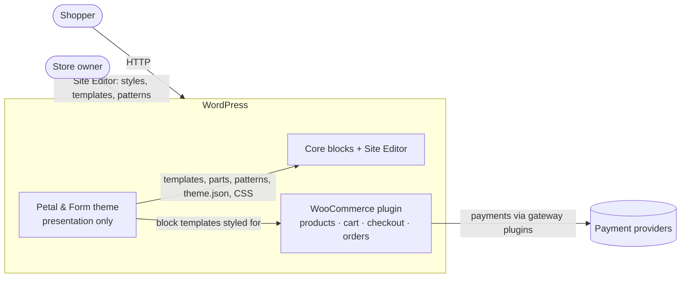
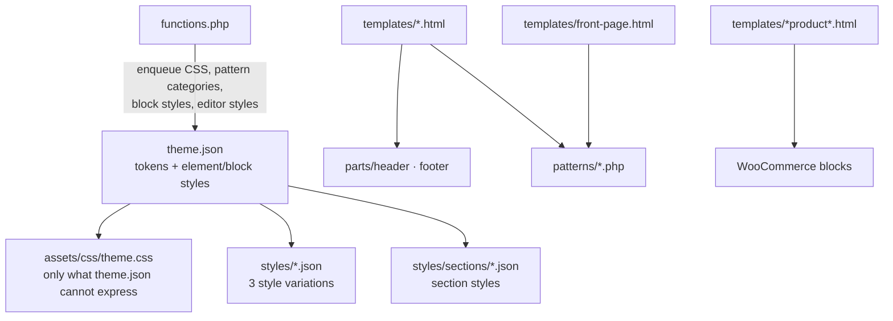

# 03 · Architecture and design specification

## 1. System context



The theme has **no** server, API, database table, JavaScript bundle or external service.

## 2. Responsibility split

| Theme (this repo) | WordPress / WooCommerce / plugins |
|---|---|
| Design tokens, global styles, style variations | Product, order, customer data |
| Templates, template parts, patterns | Cart, checkout, payments, shipping, tax |
| Header/footer/navigation presentation | Authentication, accounts |
| Product & category presentation | Inventory, transactional email |
| Fonts and decorative illustrations | Filters, reviews storage, SEO metadata |

If a future feature needs persisted data (e.g. a "gift wrap" checkbox stored on orders), it goes in a
**separate companion plugin**, never the theme (see decision log D-007).

## 3. Component architecture



### `functions.php` responsibilities (kept deliberately small)

1. Enqueue `theme.css` on front end and in the editor (`add_editor_style`).
2. Register pattern categories (`petal-and-form-*`).
3. Register a few block styles (e.g. `is-style-pf-eyebrow`, `is-style-pf-card`).
4. Nothing else. No WooCommerce hooks are required for the MVP.

## 4. Repository / file structure

```
petal-and-form/                 ← repository root
├── README.md · LICENSE · CHANGELOG.md · CONTRIBUTING.md · CODE_OF_CONDUCT.md · SECURITY.md
├── package.json               ← dev scripts only (validate, playground, zip); no dependencies at runtime
├── docs/                      ← requirements, architecture, design system, tests, guides
├── demo/                      ← seed.php + CC0 demo product images (NOT shipped in the theme zip)
├── tests/
│   ├── blueprint.json         ← WordPress Playground: WP + WooCommerce + theme + demo
│   └── scripts/               ← validate.mjs, contrast.mjs, package.mjs
├── .github/                   ← issue & PR templates, label list
└── theme/petal-and-form/      ← the installable theme (this folder is what gets zipped)
    ├── style.css · theme.json · functions.php · readme.txt · screenshot.png
    ├── templates/  parts/  patterns/
    ├── styles/                ← style variations + styles/sections/
    └── assets/{css,fonts,images}
```

## 5. Template inventory

| Template | Purpose | Notes |
|---|---|---|
| `index.html` | Ultimate fallback | Post grid |
| `home.html` | Blog index ("Journal") | Editorial post grid |
| `front-page.html` | Storefront homepage | Composed of patterns; overrides "Your homepage displays" — documented |
| `page.html` | Default page | Title + content |
| `page-wide.html` (custom) | Landing pages with no title (gift finder, about) | Registered in `customTemplates` |
| `single.html` | Blog post | Narrow reading column |
| `archive.html` | Category/tag/date/author archives | |
| `search.html` | Search results | |
| `404.html` | Not found | Friendly empty state + search |
| `archive-product.html` | Shop + product taxonomies | Uniform grid (not masonry) |
| `product-search-results.html` | Product search | |
| `single-product.html` | Product page | Two-column, gallery left |
| Cart / Checkout / Order confirmation / My account | — | WooCommerce defaults, styled by CSS + theme.json; not overridden |

Parts: `header.html`, `footer.html`, `post-meta.html`, `comments.html`.

## 6. Design tokens

See [04-design-system.md](04-design-system.md). All variations keep identical **slugs**; only values
change, so patterns never hardcode colors.

## 7. WooCommerce integration strategy

1. Declare nothing in PHP: modern WooCommerce detects block themes automatically.
2. Override only `archive-product.html`, `product-search-results.html` and `single-product.html`,
   based on WooCommerce's own block templates (copied from the installed plugin version and
   recorded in the decision log). Cart/checkout stay WooCommerce's own templates.
3. Style WooCommerce blocks with `theme.json` where possible, `theme.css` §WooCommerce otherwise,
   targeting stable `.wc-block-*` / `.wp-block-woocommerce-*` class names.
4. Header uses the `woocommerce/mini-cart` and `woocommerce/customer-account` blocks — they simply
   don't render when WooCommerce is inactive (core skips unregistered blocks).
5. Re-test overridden templates on each WooCommerce major release (test plan T-WC-*).

## 8. Security & accessibility strategy

- Patterns are PHP only to make strings translatable and image URLs portable; every dynamic value
  uses `esc_html__`, `esc_attr__`, `esc_url`. No `$_GET/$_POST` access anywhere.
- Accessibility is enforced by tokens (contrast-checked), a global `:focus-visible` ring, a skip link
  (core provides it for block themes), heading order in patterns, and reduced-motion overrides.

## 9. Testing strategy

Static checks (Node scripts, no deps) + runtime checks in WordPress Playground (WASM PHP, no server
install) + manual responsive/keyboard checks in a browser. Details: [05-test-plan.md](05-test-plan.md).

## 10. Deployment and release

`npm run zip` builds `dist/petal-and-form-<version>.zip` from `theme/petal-and-form/` only.
Releases are tagged `vX.Y.Z` with the zip attached. Public demo hosting is optional; see
[07-release-and-demo.md](07-release-and-demo.md).
